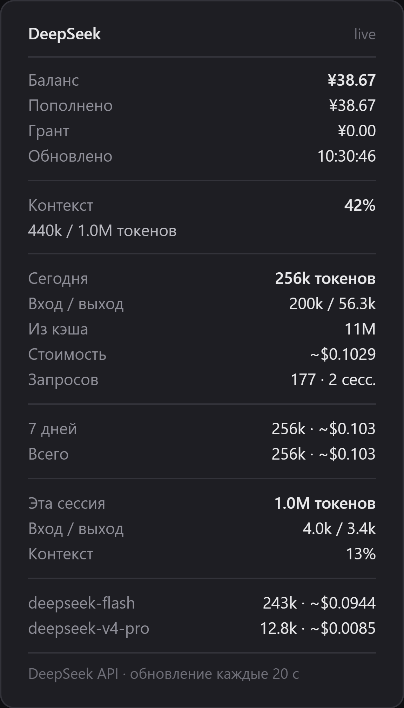

# DeepSeek Meter for Hermes

Status-bar readout for a DeepSeek account: **balance**, **context-window load**, and **today's token/cost totals**, right next to the chat.

The chip reads `● ¥38.67 · 42% · 256k` — balance, context fill, tokens today. Click it for the breakdown: balance (total / topped-up / granted), context fill with a bar, today's input/output/cached tokens and estimated cost, the last 7 days, the current session, and a per-model split.



## What it shows

| Value | Source |
|---|---|
| Balance, topped-up, granted | `GET https://api.deepseek.com/user/balance` (key from Hermes' secret store) |
| Context load % + bar | the live per-session usage Hermes already streams to the desktop (`host.state.focusedUsage`) |
| Today / 7 days / all-time tokens and cost | aggregates from `session_model_usage` in the local `state.db` |
| Per-model split | same table, grouped by model |

Costs are Hermes' own estimate in USD (it bills nothing itself); the balance is in whatever currency the DeepSeek account uses (CNY on CN accounts).

## Install

```bash
# once listed in the catalog
hermes plugins install deepseek-meter

# straight from Git, before/without the catalog
hermes plugins install https://github.com/samieshmil-blip/hermes-deepseek-meter
```

Then set the key (or reuse the one Hermes already uses for the provider):

```bash
hermes config set env.DEEPSEEK_API_KEY sk-...   # or put it in ~/.hermes/.env yourself
```

The desktop half is opt-in, like every plugin-carried UI: enable **DeepSeek Meter** in *Capabilities → Plugins* once. The status-bar chip appears after the next desktop reload.

## Requirements

- Hermes `>= 0.23.0` (Desktop plugin SDK with `host.state.focusedUsage`).
- `DEEPSEEK_API_KEY` — the same key Hermes uses to talk to DeepSeek.
- A DeepSeek account with balance on it (obviously).

## Disclosure

What this plugin touches, in full:

- **Network:** exactly one outbound call — `GET https://api.deepseek.com/user/balance` with `Authorization: Bearer $DEEPSEEK_API_KEY`. Nothing else leaves the machine.
- **Credentials:** the key is read through Hermes' own profile-scoped route (`agent.secret_scope.get_secret`), never from a file this plugin parses, and is never returned to the desktop renderer or logged. It is not stored, refreshed or transmitted anywhere but the call above.
- **Local reads:** `$HERMES_HOME/state.db` opened read-only (`mode=ro`), table `session_model_usage` only — token counts, call counts, estimated cost, timestamps, model name. No message text, titles, prompts or tool output are read.
- **No writes** to Hermes state, no tools, hooks, middleware or core patching: two `GET` routes (`/api/plugins/deepseek-meter/stats`, `/balance`).
- **No telemetry, no analytics, no self-updater.**

## Layout

```
plugin.yaml                  manifest (agent half)
__init__.py                  package marker
dashboard/manifest.json      dashboard backend declaration
dashboard/plugin_api.py      GET /stats, /balance — balance call + local aggregates
desktop/plugin.js            status-bar chip + panel (Desktop plugin SDK)
```

## Development

```bash
hermes plugins validate . --install-deps   # the same check catalog CI runs
hermes plugins doctor .                    # runtime contracts
```

The desktop half hot-reloads: edit `desktop/plugin.js`, save, and the app picks it up (⌘K → *Reload desktop plugins* if it doesn't).

## License

MIT — see [LICENSE](LICENSE).
